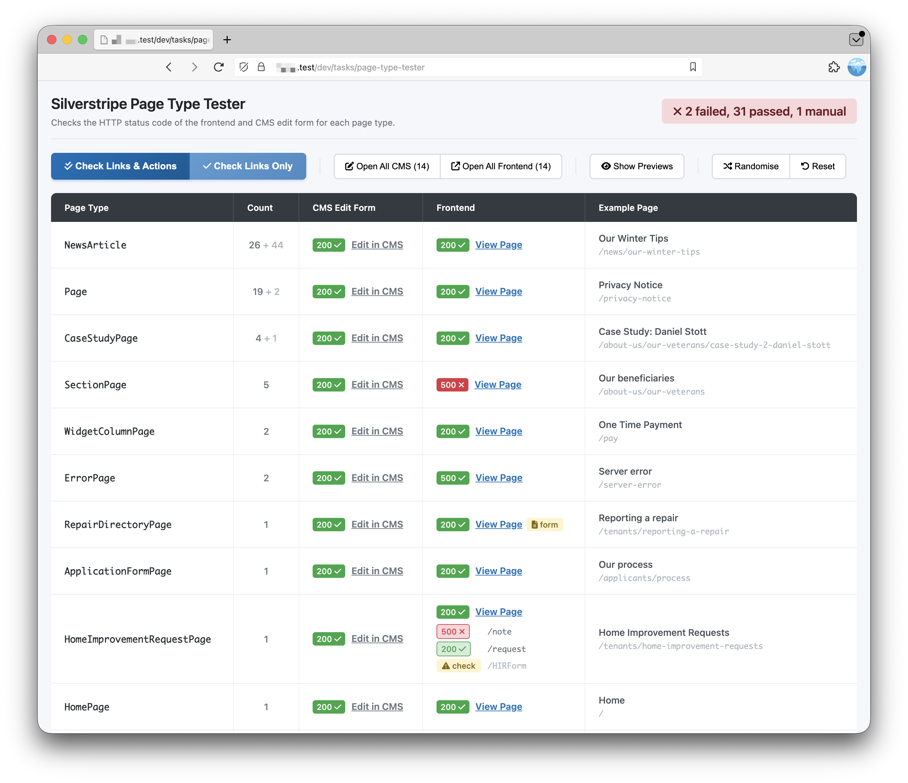

# Check Page Type Statuses

A dev task that checks every page type on a Silverstripe site still works. I use it after upgrades: it picks an example page of each type and checks its CMS edit form, its frontend and its controller actions, then lets you tick each one off as you test it by hand.



## Install

```bash
composer require purplespider/silverstripe-page-type-status-checker
```

Needs Silverstripe 6 and PHP 8.1+.

## Use

Visit `/dev/tasks/check-page-type-statuses` while logged in as an admin. The checks start on their own.

Or from the command line:

```bash
vendor/bin/sake tasks:check-page-type-statuses
```

The CLI logs itself in to the CMS as the first admin, so it checks everything the browser does. It uses Silverstripe's own "remember me" login, which is deleted when the run finishes (or by the next run, if one was killed), and doesn't touch that admin's other logins. Its expiry allows for the web server running in a different timezone from the CLI, as Herd's do. It exits non-zero if anything fails.

The login only works on a site that shares this database, so with `--base-url` pointing at live, the CMS links show as "login required".

| Option | |
| --- | --- |
| `--skip-actions` | Don't check controller actions |
| `--skip-admin` | Don't check ModelAdmins and Settings |
| `--skip-blocks` | Don't check Elemental blocks |
| `--randomise` | Pick a random example page of each type |
| `--live-domain=URL` | Add links to the same pages on the live site, with a side-by-side Compare button |
| `--verify-ssl=0\|1` | Off by default in dev mode |
| `--base-url=URL` | CLI only. Check this URL instead of `SS_BASE_URL`, e.g. the local Herd URL |
| `--json` | CLI only. Print the results as JSON |
| `--as=EMAIL` | CLI only. Check as this CMS user instead of the first admin |
| `--no-login` | CLI only. Check without logging in |

The ones that aren't CLI only work as query string parameters in the browser too.

`--json` gives a summary and every check, handy for comparing runs before and after an upgrade:

```json
{
    "site": "Example",
    "cms": "Silverstripe 6.2.11",
    "base_url": "https://example.test",
    "checked_as": "admin@example.com",
    "summary": { "checked": 29, "passed": 27, "failed": 1, "warnings": 1, "login_required": 0 },
    "checks": [
        { "subject": "NewsHolder", "label": "Action /rss", "url": "https://example.test/news/rss",
          "status": 200, "outcome": "pass", "problem": null, "redirect": null }
    ]
}
```

`outcome` is `pass`, `fail`, `warning`, `login_required` or `not_found` (an action with no link to it on the page).

## What it checks

- **Pages:** the CMS edit form, Settings and History, the frontend, and any `$allowed_actions` linked from the page. Also the edit and add forms behind each GridField on the edit form.
- **Blocks** (with Elemental): one of each type, in the CMS block list, its edit form, and rendered on its own.
- **Admin:** each ModelAdmin and Settings, plus an edit and add form for each model. Member and Group add forms need sudo mode, so the CLI skips them.

A 200 isn't automatically a pass. A page still fails if it shows a PHP error, debug output, unrendered template code or a raw shortcode, or has no title. Links that are broken in the way Silverstripe 6 tends to break them (`https://example.comSecurity/logout`) get an orange warning.

Redirects aren't followed, so a page that quietly redirects somewhere else shows up. Pages that only exist in draft are checked with `?stage=Stage`.

It also flags any page type, block or admin whose code sends email, so you know which forms to submit and which inboxes to watch. It does this by reading the code, so nothing is actually sent.

## Other handy bits

- **Create** buttons add a draft test page or block for types that don't have one, and delete them again afterwards.
- **Tested** ticks are stored in your browser's local storage, so they survive pulling down a fresh copy of the live database. They aren't shared with anyone else.
- **Open All** opens every CMS or frontend link in a table in new tabs.

## Config

```yaml
PurpleSpider\PageTypeTester\Report\HtmlReport:
  check_concurrency: 6 # lower this for slow sites

PurpleSpider\PageTypeTester\ActionLinkFinder:
  direct_actions: # actions to check even with no link on the page
    - rss
```

`EmailUsageFinder` has `mail_classes`, `mail_functions` and `reference_depth` if you need to teach it about another mail library.

## Live CMS links keep asking me to log in

Silverstripe 6 changed the session cookie to `SameSite=Strict`, so the browser drops your login when you arrive from another site. Either log in when it asks (you'll be sent back to the right page), or put the old behaviour back on the live site:

```yaml
SilverStripe\Control\Session:
  cookie_samesite: 'Lax'
```

## Licence

BSD-3-Clause
